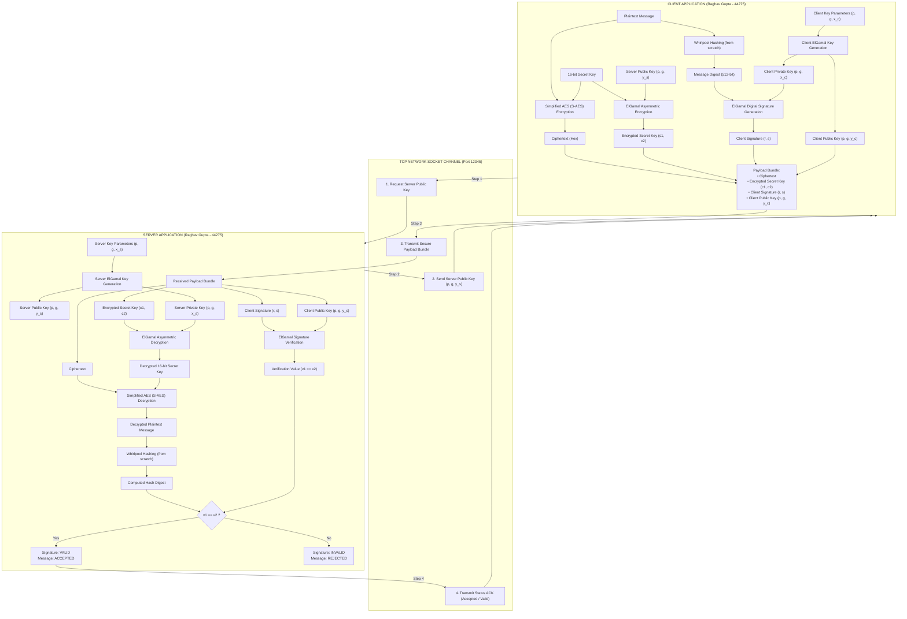
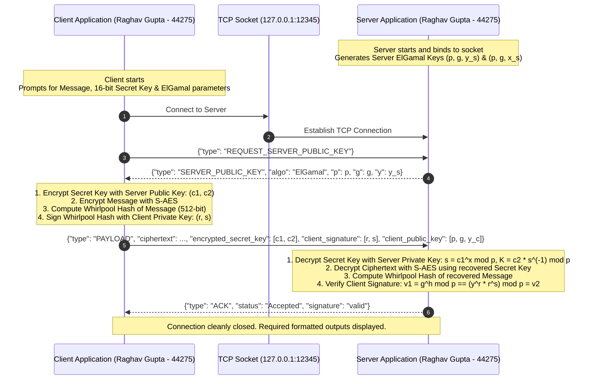
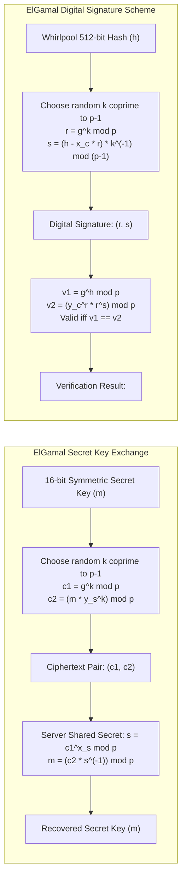
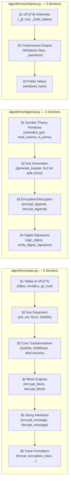

# Secure Client-Server Message Exchange Protocol
### Cryptography & Information Security - Assignment 1


-success?style=for-the-badge)

---

## Academic Credentials & Metadata

* **Author:** Raghav Gupta
* **Registration / Roll Number:** 44275
* **Degree:** Bachelor of Technology (B.Tech)
* **Branch:** Computer Science and Engineering
* **Department:** Department of Computer Science & Engineering (CSED)
* **Institution:** Motilal Nehru National Institute of Technology (MNNIT) Allahabad
* **Course:** Information Security / Cryptography & Network Security

---

## 1. Algorithm Selection Mapping

Based on the assignment formula from Page 3 of the question paper using Roll Number **44275**:

### 1.1 Symmetric Key Algorithm Assignment
$$\text{Roll No.} \pmod 3 = 44275 \pmod 3$$
$$\text{Sum of digits} = 4 + 4 + 2 + 7 + 5 = 22$$
$$22 \pmod 3 = 1 \implies \mathbf{AES\ variant\ (Simplified\ AES\ /\ S\text{-}AES)}$$

*Reference: Question Paper Page 3, Item 1: "else if (your_rollNo.)%3=1, use AES variant"*

### 1.2 Asymmetric Key Algorithm Assignment
$$\text{Roll No.} \pmod 2 = 44275 \pmod 2 = 1 \implies \mathbf{Elgamal}$$

*Reference: Question Paper Page 3, Item 2: "else use Elgamal"*

### 1.3 Cryptographic Hash Algorithm
$$\mathbf{Whirlpool\ Hash\ Algorithm\ (Created\ from\ Scratch\ -\ ISO/IEC\ 10118\text{-}3)}$$

*Reference: Question Paper Page 1: "The hashing will be done using the Whirlpool hash algorithm created from scratch."*

---

## 2. Visual Architecture & Protocol Diagrams

### 2.1 Complete End-to-End System Flowchart
The diagram below illustrates the exact cryptographic workflow implemented across the Client and Server processes (matching the assignment specification on Page 1):



---

### 2.2 Protocol Handshake & Message Sequence Diagram
The time-ordered network interaction between the Client and Server:



---

### 2.3 Simplified AES (S-AES) Cryptographic Engine
The block-by-block data path of the 16-bit key schedule and 2-round Substitution-Permutation Network (SPN):

```mermaid
flowchart TD
    subgraph KeySchedule["S-AES Key Expansion (16-bit Master Key)"]
        MasterKey["16-bit Master Key (w0, w1)"] --> W0W1["w0 (bits 15..8), w1 (bits 7..0)"]
        W0W1 --> Round0Key["Round 0 Key (K0 = w0 || w1)"]
        
        W0W1 --> G1["g(w1) = SubNib(RotNib(w1)) ^ Rcon(1)"]
        G1 --> W2["w2 = w0 ^ g(w1)"]
        W2 --> W3["w3 = w2 ^ w1"]
        W3 --> Round1Key["Round 1 Key (K1 = w2 || w3)"]
        
        W3 --> G2["g(w3) = SubNib(RotNib(w3)) ^ Rcon(2)"]
        G2 --> W4["w4 = w2 ^ g(w3)"]
        W4 --> W5["w5 = w4 ^ w3"]
        W5 --> Round2Key["Round 2 Key (K2 = w4 || w5)"]
    end

    subgraph SPNEngine["S-AES 2-Round SPN Encryption Engine"]
        PT["16-bit Plaintext Block"] --> MatrixMap["Map to 2x2 State Matrix:\n[[s00, s01], [s10, s11]]"]
        MatrixMap --> ARK0["AddRoundKey (K0)"]
        
        ARK0 --> Sub1["Round 1: SubNibbles (4-bit S-Box)"]
        Sub1 --> Shift1["Round 1: ShiftRows (Swap s10 and s11)"]
        Shift1 --> Mix1["Round 1: MixColumns over GF(2^4)\nMatrix: [[1, 4], [4, 1]]"]
        Mix1 --> ARK1["Round 1: AddRoundKey (K1)"]
        
        ARK1 --> Sub2["Round 2: SubNibbles (4-bit S-Box)"]
        Sub2 --> Shift2["Round 2: ShiftRows (Swap s10 and s11)"]
        Shift2 --> ARK2["Round 2: AddRoundKey (K2)\n(MixColumns skipped in final round)"]
        
        ARK2 --> CT["16-bit Ciphertext Block"]
    end
```



---

### 2.4 ElGamal Cryptosystem & Digital Signature Engine



---

## 3. Mathematical Specifications

### 3.1 Simplified Advanced Encryption Standard (S-AES)
S-AES operates on a 16-bit block under a 16-bit master key using arithmetic in the Galois Field $GF(2^4)$ modulo the irreducible polynomial:
$$m(x) = x^4 + x + 1 \quad (\text{binary } 10011_2 = \texttt{0x13})$$

- **State Representation:** 16 bits are structured as a $2 \times 2$ matrix of 4-bit nibbles:
  $$\begin{pmatrix} s_{00} & s_{01} \\ s_{10} & s_{11} \end{pmatrix}$$
- **S-Box (4-bit non-linear substitution):**
  $$\text{S-Box} = [9, 4, A, B, D, 1, 8, 5, 6, 2, 0, 3, C, E, F, 7]$$
  $$\text{Inv S-Box} = [A, 5, 9, B, 1, 7, 8, F, 6, 0, 2, 3, C, 4, D, E]$$
- **MixColumns Matrix Multiplication:**
  $$\begin{pmatrix} s'_{00} & s'_{01} \\ s'_{10} & s'_{11} \end{pmatrix} = \begin{pmatrix} 1 & 4 \\ 4 & 1 \end{pmatrix} \otimes \begin{pmatrix} s_{00} & s_{01} \\ s_{10} & s_{11} \end{pmatrix} \pmod{x^4 + x + 1}$$
- **Inverse MixColumns Matrix:**
  $$\begin{pmatrix} 1 & 4 \\ 4 & 1 \end{pmatrix}^{-1} = \begin{pmatrix} 9 & 2 \\ 2 & 9 \end{pmatrix} \pmod{x^4 + x + 1}$$
- **Key Expansion:**
  - $w_0 = \text{Key}[15..8], \quad w_1 = \text{Key}[7..0]$
  - $w_2 = w_0 \oplus \text{Rcon}(1) \oplus \text{SubNib}(\text{RotNib}(w_1))$ where $\text{Rcon}(1) = \texttt{0x80}$
  - $w_3 = w_2 \oplus w_1$
  - $w_4 = w_2 \oplus \text{Rcon}(2) \oplus \text{SubNib}(\text{RotNib}(w_3))$ where $\text{Rcon}(2) = \texttt{0x30}$
  - $w_5 = w_4 \oplus w_3$
  - Round keys: $K_0 = (w_0, w_1), \quad K_1 = (w_2, w_3), \quad K_2 = (w_4, w_5)$.

### 3.2 ElGamal Public Key Cryptosystem & Digital Signatures
Based on the hardness of the Discrete Logarithm Problem (DLP) in $\mathbb{Z}_p^*$:
- **Key Generation:**
  - Large prime $p$ (512-bit safe prime) and generator $g \in \mathbb{Z}_p^*$.
  - Private key: random integer $x \in [2, p - 2]$.
  - Public key: $y = g^x \pmod p$.
  - Public key tuple: $(p, g, y)$, Private key tuple: $(p, g, x)$.
- **Secret Key Encryption:**
  - Choose random ephemeral key $k \in [2, p - 2]$ with $\gcd(k, p - 1) = 1$.
  - $c_1 = g^k \pmod p$.
  - $c_2 = (m \cdot y^k) \pmod p$.
  - Ciphertext: $(c_1, c_2)$.
- **Secret Key Decryption:**
  - Shared secret: $s = c_1^x \pmod p$.
  - Modular inverse: $s^{-1} \pmod p$ via Extended Euclidean Algorithm.
  - Recovered secret key: $m = (c_2 \cdot s^{-1}) \pmod p$.
- **Digital Signature Generation:**
  - Message hash integer: $h = H(M) \pmod{p - 1}$.
  - Ephemeral key: $k \in [2, p - 2]$ with $\gcd(k, p - 1) = 1$.
  - $r = g^k \pmod p$.
  - $s = (k^{-1} \cdot (h - x \cdot r)) \pmod{p - 1}$.
  - Signature: $(r, s)$.
- **Digital Signature Verification:**
  - $v_1 = g^h \pmod p$.
  - $v_2 = (y^r \cdot r^s) \pmod p$.
  - Signature is valid if and only if $v_1 \equiv v_2 \pmod p$.

### 3.3 Whirlpool Cryptographic Hash Function (from scratch)
- **Miyaguchi-Preneel Hashing Construction:**
  $$H_i = W(H_{i-1}, m_i) \oplus H_{i-1} \oplus m_i$$
- **Padding Rule:** Append '1' bit (`0x80`), followed by $k$ zero bits such that $(L + 1 + k) \equiv 256 \pmod{512}$, then append the 256-bit big-endian representation of original bit-length $L$.
- **Galois Field Arithmetic:** Polynomial multiplication over $GF(2^8)$ modulo irreducible polynomial $x^8 + x^4 + x^3 + x^2 + 1$ (`0x11D`).
- **Diffusion Matrix:** Circulant row $[01, 01, 04, 01, 08, 05, 02, 09]$.

---

## 4. Complete Directory of Modular Packages, Files and Functions

The project follows a strict modular separation of concerns:
```text
crypto assignment/
├── algorithms/                      <-- Core cryptographic algorithms
│   ├── __init__.py                  <-- Unified package interface
│   ├── saes.py                      <-- Part 1: Simplified AES (S-AES / AES Variant)
│   ├── elgamal.py                   <-- Part 2: ElGamal Cryptosystem & Digital Signatures
│   └── whirlpool.py                 <-- Part 3: ISO Whirlpool Hash (From scratch)
├── network/                         <-- Network communication layer
│   ├── __init__.py                  <-- Package interface
│   └── protocol.py                  <-- Packet schemas & socket framing
├── client.py                        <-- Client application entry point
├── server.py                        <-- Server application entry point
├── main.py                          <-- Master interactive CLI launcher
├── run.bat                          <-- Windows 1-click desktop launcher
├── test_suite.py                    <-- Comprehensive unit test suite (5/5 tests passing)
├── run_demo.py                      <-- Automated batch runner & screenshot generator
├── saes.py                          <-- Root re-exporter for S-AES
├── elgamal.py                       <-- Root re-exporter for ElGamal
├── whirlpool.py                     <-- Root re-exporter for Whirlpool
├── .gitignore                       <-- Professional git ignore configuration
├── README.md                        <-- Comprehensive academic documentation
├── INSTRUCTIONS_AND_SUBMISSION.md   <-- Instructor evaluation guide
├── client_output.txt                <-- Captured client execution log
├── server_output.txt                <-- Captured server execution log
├── client_execution_screenshot.png  <-- Client execution window screenshot
├── server_execution_screenshot.png  <-- Server execution window screenshot
└── 44275_Raghav_Gupta.zip           <-- Final submission archive
```

### 4.1 Detailed Module and Function Specifications

| Module / File | Internal Sections | Functions / Classes | Purpose & Functionality |
| :--- | :--- | :--- | :--- |
| **`algorithms/saes.py`** | **6 Sections:**<br>§1 Lookup Tables & GF(2⁴) Arithmetic<br>§2 Key Expansion (w0..w5)<br>§3 Core S-AES Transformations<br>§4 Block Engines with Trace<br>§5 String Encryption/Decryption<br>§6 Trace Formatters | `gf_mult(a, b)`<br>`generate_subkeys(key)`<br>`sub_nibbles(m)`<br>`shift_rows(m)`<br>`mix_columns(m)`<br>`inv_mix_columns(m)`<br>`encrypt_block(pt, key)`<br>`decrypt_block(ct, key)`<br>`encrypt_message(msg, key)`<br>`decrypt_message(ct, key)`<br>`format_encryption_trace(...)`<br>`format_decryption_trace(...)` | **Part 1 Symmetric Block Cipher (Roll % 3 = 1).** Implements Simplified AES (S-AES) operating on 16-bit blocks under 16-bit keys over $GF(2^4)$. Expands key into 3 round keys ($w_0..w_5$), performs 2-round SPN encryption/decryption with full intermediate tracing. Verified against Musa et al. textbook vector (`0x4AF5` + `0xD728` $\to$ `0x24EC`). |
| **`algorithms/elgamal.py`** | **4 Sections:**<br>§1 Number Theory Primitives<br>§2 Key Generation<br>§3 Asymmetric Encryption/Decryption<br>§4 Digital Signatures | `extended_gcd(a, b)`<br>`mod_inverse(a, m)`<br>`is_prime(n, k)`<br>`generate_prime(bits)`<br>`generate_keypair(p, g, x)`<br>`encrypt_elgamal(m, pub)`<br>`decrypt_elgamal(c, priv)`<br>`sign_digest(digest, priv)`<br>`verify_digest_signature(d, sig, pub)` | **Part 2 Asymmetric Cryptosystem (Roll % 2 = 1).** Implements ElGamal public key encryption and digital signature scheme using verified 512-bit safe prime. Supports secret key encryption/decryption and 512-bit Whirlpool digital signature signing and verification ($v_1 == v_2$). |
| **`algorithms/whirlpool.py`** | **3 Sections:**<br>§1 GF(2⁸) Arithmetic & Tables<br>§2 Compression Engine<br>§3 Convenience Helper | `_gf_mul(a, b)`<br>`_build_tables()`<br>`Whirlpool` class<br>`Whirlpool.update(data)`<br>`Whirlpool._transform(block)`<br>`whirlpool_hash(data)` | **Part 3 Cryptographic Hash (from scratch).** Pure Python ISO/IEC 10118-3 implementation. Performs $GF(2^8)$ multiplication modulo irreducible polynomial `0x11D`, precomputes circular round tables, runs 10-round Miyaguchi-Preneel compression, and generates 512-bit digests (128 hex chars). |
| **`algorithms/__init__.py`** | — | Unified Package API | Exposes unified algorithm interfaces for modular imports. |
| **`network/protocol.py`** | — | `MessageProtocol`<br>`send_json(sock, dict)`<br>`recv_json(sock, buffer)` | **Network Framing & Schemas.** Defines standard message schemas (`REQ_PUBLIC_KEY`, `RESP_PUBLIC_KEY`, `PAYLOAD`, `ACK`), handles JSON framing, newline delimitation, and socket serialization for both ElGamal $(p, g, y)$ and RSA schemas. |
| **`network/__init__.py`** | — | Network Package API | Exposes protocol message builders and transmission functions. |
| **`server.py`** | Step-by-step comments cite exact **Page 2 & Page 3** bullet points | `get_interactive_server_inputs()`<br>`run_server(...)`<br>`main()` | **Server Application Entry Point.** Prompts for/generates Server ElGamal keys, coordinates socket connection, decrypts secret key with ElGamal, decrypts ciphertext with S-AES, hashes recovered message with Whirlpool, verifies digital signature, and prints formatted output. |
| **`client.py`** | Step-by-step comments cite exact **Page 1 & Page 2** bullet points | `get_interactive_inputs()`<br>`run_client(...)`<br>`main()` | **Client Application Entry Point.** Prompts for Message, 16-bit Secret Key, and ElGamal key parameters, retrieves Server Public Key, encrypts secret key with ElGamal, encrypts message with S-AES, hashes message with Whirlpool, signs hash with ElGamal, and transmits payload bundle. |
| **`main.py`** | — | `run_side_by_side_demo()`<br>`run_inline_server()`<br>`run_inline_client()`<br>`run_test_suite()`<br>`run_batch_demo()`<br>`package_zip()` | **Master Control Panel.** Interactive numbered CLI menu enabling multi-window demo launches, interactive testing, and automated zip re-packaging to `44275_Raghav_Gupta.zip`. |
| **`run_demo.py`** | — | `capture_execution()`<br>`render_terminal_screenshot()` | **Automated Demo & Visualizer.** Runs client and server end-to-end, logs stdout to `.txt` files, and renders high-resolution Windows terminal window screenshots (`.png`). |
| **`run.bat`** | — | Windows Batch Script | One-click desktop launcher to immediately start `main.py` in Windows. |
| **`test_suite.py`** | `TestCryptoAssignment` | Comprehensive unit tests for S-AES textbook vectors, Whirlpool ISO vectors, ElGamal key exchange & signature arithmetic, and socket network integration. |
| **`client_output.txt`, `server_output.txt`** | — | Text Logs | Raw execution output logs for Client and Server matching the exact required format. |
| **`client_execution_screenshot.png`, `server_execution_screenshot.png`** | — | Images | Rendered terminal window screenshots of Client encryption and Server decryption. |
| **`INSTRUCTIONS_AND_SUBMISSION.md`** | — | Evaluation Report | Mapping of assignment requirements to code with grading audit. |
| **`44275_Raghav_Gupta.zip`** | — | Zip Archive | Final submission package containing all modules and documentation. |

---

## 5. Academic Code Annotations Guide

Every `.py` file in this project is structured for easy inspection by an evaluator or professor. Each algorithm file is divided into numbered **SECTION banners** visible at the top level without any IDE navigation required.

### 5.1 How to Navigate the Source Code

Open any algorithm file — the section banners appear as large block comments:

```python
# ============================================================================
# SECTION 1: LOOKUP TABLES & GALOIS FIELD GF(2^4) ARITHMETIC
# ============================================================================
```

This makes it immediately clear **where each part of the algorithm lives** and **which textbook it comes from**.

### 5.2 Per-File Annotation Structure



### 5.3 client.py & server.py Question Paper Citations

Both `client.py` and `server.py` contain inline comments that map each processing step directly to the exact bullet point from the assignment question paper:

```python
# --- STEP 2 (Page 1, Bullet 2): Encrypt Secret Key with Server's Public Key ---
# The 16-bit integer secret key is encrypted using ElGamal:
# c1 = g^k mod p, c2 = (m * y^k) mod p
encrypted_secret_key = encrypt_elgamal(secret_key_int, server_pub_key)
```

This allows an evaluator to cross-reference every function call directly with the question paper.

---

## 6. Execution Instructions for Evaluation

The entire application runs through a single command with **zero external dependencies**:

```powershell
py main.py
```

Running `py main.py` launches the master interactive control panel:
* **Select `[1]` — 🚀 Launch Live Side-by-Side Demo:** Automatically spawns Server and Client in two terminal windows side-by-side on your desktop, performing the full handshake, key exchange, encryption, signing, and verification live.
* **Select `[2]` — 🖥️ Start Server:** Runs the Server in the current console.
* **Select `[3]` — 📱 Start Client:** Runs the Client interactively to test custom messages and keys.
* **Select `[4]` — 🧪 Run Automated Tests:** Executes all 5 unit and integration tests (`test_suite.py`).
* **Select `[5]` — 📸 Generate Output & Screenshots:** Runs batch demo and updates output `.txt` logs and `.png` screenshots.
* **Select `[6]` — 📦 Package Submission ZIP:** Packages all files into `44275_Raghav_Gupta.zip`.

---

## 7. Exact Formatted Execution Output

### 7.1 Client Side Output (Matches Required Template):
```text
Client Side:
Input: Message: <ANTIGRAVITY SECURE PROTOCOL - RAGHAV GUPTA (44275)>
Secret Key: <1010000010110001>
Public Key parameters: (p=12293254424529995456056407361148908763143109507734274508329448260524737144125266800879924396373184003698000873100225257723659125894915287167837699233525579, g=2, y=3804895401559689655862200839060345166583763361410594766600084040093860173508462453074398223619182662148977907100240253708405600329624639601130833990485791)
Private key parameters: (p=12293254424529995456056407361148908763143109507734274508329448260524737144125266800879924396373184003698000873100225257723659125894915287167837699233525579, g=2, x=981241203004466191433789562586965277298312233855098834638071294380514186091746842120952573022009462846401589868136415003908135082608648811729119605807920)
Encrypted Secret Key: <(209318762347443524821934006926186258970835384143114239476448045128563393233237955761397351664862709663407615429275527803482316372888419663048782861626897, 8626347169629634849238920973825026959777681773683911060222933728327836272264216638299493632190883041585524298462232550187042584280770298312623587890141963)>

Intermediate encryption process:
--- Intermediate Encryption Process (Simplified AES) ---
1. Key Schedule Expansion (16-bit master key: 0xA0B1 = 1010000010110001b):
   Words w0, w1 : w0 = 0xA0 (10100000b), w1 = 0xB1 (10110001b)
   Words w2, w3 : w2 = 0x63 (01100011b), w3 = 0xD2 (11010010b)
   Words w4, w5 : w4 = 0xFD (11111101b), w5 = 0x2F (00101111b)
   -> Round 0 Key (K0): 0xA0B1 (1010000010110001b)
   -> Round 1 Key (K1): 0x63D2 (0110001111010010b)
   -> Round 2 Key (K2): 0xFD2F (1111110100101111b)

2. Block-by-Block S-AES Encryption (showing 3 of 25 block(s)):
   [Block 1: Chars 'AN' (16-bit: 0x414E = 0100000101001110b)]
     -> Round 0 AddRoundKey (K0): 0xE1FF
     -> Round 1 SubNibbles      : 0xF477
     -> Round 1 ShiftRows       : 0xF774
     -> Round 1 MixColumns      : 0x0E4B
     -> Round 1 AddRoundKey (K1): 0x6D99
     -> Round 2 SubNibbles      : 0x8E22
     -> Round 2 ShiftRows       : 0x822E
     -> Round 2 AddRoundKey (K2): 0x7F01 (Cipher block: 0x7F01)
   [Block 2: Chars 'TI' (16-bit: 0x5449 = 0101010001001001b)]
     -> Round 0 AddRoundKey (K0): 0xF4F8
     -> Round 1 SubNibbles      : 0x7D76
     -> Round 1 ShiftRows       : 0x767D
     -> Round 1 MixColumns      : 0xC962
     -> Round 1 AddRoundKey (K1): 0xAAB0
     -> Round 2 SubNibbles      : 0x0039
     -> Round 2 ShiftRows       : 0x0930
     -> Round 2 AddRoundKey (K2): 0xF41F (Cipher block: 0xF41F)
   [Block 3: Chars 'GR' (16-bit: 0x4752 = 0100011101010010b)]
     -> Round 0 AddRoundKey (K0): 0xE7E3
     -> Round 1 SubNibbles      : 0xF5FB
     -> Round 1 ShiftRows       : 0xFBF5
     -> Round 1 MixColumns      : 0x528C
     -> Round 1 AddRoundKey (K1): 0x315E
     -> Round 2 SubNibbles      : 0xB41F
     -> Round 2 ShiftRows       : 0xBF14
     -> Round 2 AddRoundKey (K2): 0x423B (Cipher block: 0x423B)
   ... (22 remaining 16-bit block(s) encrypted similarly)

Cipher text: <7f01f41f423b0a681f2c5b7965bb944a68fb47b398f4941465bef520408348febbc90a6870465da9441e96cf602f56348e11>
Hash code: <366db1b285510c6290071cc42e2b58e8c31d0b8324f0e5e01a900d8d7ce139c60a7bba9d9c4ad04f53aafc0381272a589d0029f3ebc89a47e48018c0f44fdab8>
Digital Signature: <(3029996533715078448551045257638245032465352629287590975454415834359782670007785524342055090234373174168114471415086034880174279829063566292297972571438746, 3060065496505800416404218319773607080013196357033616973205090067291475116217251962425832343016274886395764649795597827409541999679887283767392142173848160)>
```

### 7.2 Server Side Output (Matches Required Template):
```text
Server Side:
Input: Public Key parameters: (p=12293254424529995456056407361148908763143109507734274508329448260524737144125266800879924396373184003698000873100225257723659125894915287167837699233525579, g=2, y=1499601541770446654510951837842377753681217025596591092574487257796640062244609357631381718862417806463383873750595499721393169904834664322466136621614325)
       Private key parameters: (p=12293254424529995456056407361148908763143109507734274508329448260524737144125266800879924396373184003698000873100225257723659125894915287167837699233525579, g=2, x=12214391907657448793553231211945283294757557465126731143880363206452679697624150896317326178777200425434880551102524383340789393125044860753637461755505790)
Decrypted Secret key: 1010000010110001 (integer: 41137)

Intermediate decryption process:
--- Intermediate Decryption Process (Simplified AES) ---
1. Round Subkeys Applied in Reverse Order:
   Round 2 Key (K2): 0xFD2F (1111110100101111b)
   Round 1 Key (K1): 0x63D2 (0110001111010010b)
   Round 0 Key (K0): 0xA0B1 (1010000010110001b)

2. Block-by-Block S-AES Decryption (showing 3 of 25 block(s)):
   [Block 1: Cipher 0x7F01 (0111111100000001b)]
     -> AddRoundKey (K2)        : 0x822E
     -> InvShiftRows            : 0x8E22
     -> InvSubNibbles           : 0x6D99
     -> AddRoundKey (K1)        : 0x0E4B
     -> InvMixColumns           : 0xF774
     -> InvShiftRows            : 0xF477
     -> InvSubNibbles           : 0xE1FF
     -> AddRoundKey (K0)        : 0x414E -> Decrypted Chars: 'AN'
   [Block 2: Cipher 0xF41F (1111010000011111b)]
     -> AddRoundKey (K2)        : 0x0930
     -> InvShiftRows            : 0x0039
     -> InvSubNibbles           : 0xAAB0
     -> AddRoundKey (K1)        : 0xC962
     -> InvMixColumns           : 0x767D
     -> InvShiftRows            : 0x7D76
     -> InvSubNibbles           : 0xF4F8
     -> AddRoundKey (K0)        : 0x5449 -> Decrypted Chars: 'TI'
   [Block 3: Cipher 0x423B (0100001000111011b)]
     -> AddRoundKey (K2)        : 0xBF14
     -> InvShiftRows            : 0xB41F
     -> InvSubNibbles           : 0x315E
     -> AddRoundKey (K1)        : 0x528C
     -> InvMixColumns           : 0xFBF5
     -> InvShiftRows            : 0xF5FB
     -> InvSubNibbles           : 0xE7E3
     -> AddRoundKey (K0)        : 0x4752 -> Decrypted Chars: 'GR'
   ... (22 remaining 16-bit block(s) decrypted similarly)

Decrypt Message: ANTIGRAVITY SECURE PROTOCOL - RAGHAV GUPTA (44275)
Hash code: 366db1b285510c6290071cc42e2b58e8c31d0b8324f0e5e01a900d8d7ce139c60a7bba9d9c4ad04f53aafc0381272a589d0029f3ebc89a47e48018c0f44fdab8
Verification code: 366db1b285510c6290071cc42e2b58e8c31d0b8324f0e5e01a900d8d7ce139c60a7bba9d9c4ad04f53aafc0381272a589d0029f3ebc89a47e48018c0f44fdab8
Signature: <valid>
Message: <Accepted>
```

---

## 8. Submission Checklist Verification

- [x] **Platform Independent & Command Line Executable (Rule 1):** Pure Python 3 standard library, executable on any OS without pip dependencies.
- [x] **Author Details in Every Code File (Rule 2):** Name (`Raghav Gupta`) and Roll Number (`44275`) explicitly stated in every file header and docstring.
- [x] **Detailed README File (Rule 3):** Complete guide with visual architecture diagrams, mathematical proofs, and function directories.
- [x] **ZIP File for Submission (Rule 4):** Fully bundled in `44275_Raghav_Gupta.zip`.
- [x] **Sample Output Files & Screenshots (Rule 5):** Text logs (`client_output.txt`, `server_output.txt`) and high-resolution terminal window screenshots (`client_execution_screenshot.png`, `server_execution_screenshot.png`).
- [x] **ZIP Renamed Correctly (Rule 6):** Formatted as `44275_Raghav_Gupta.zip`.
