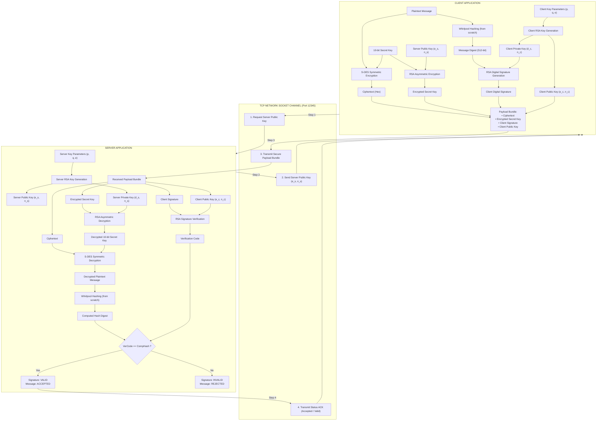
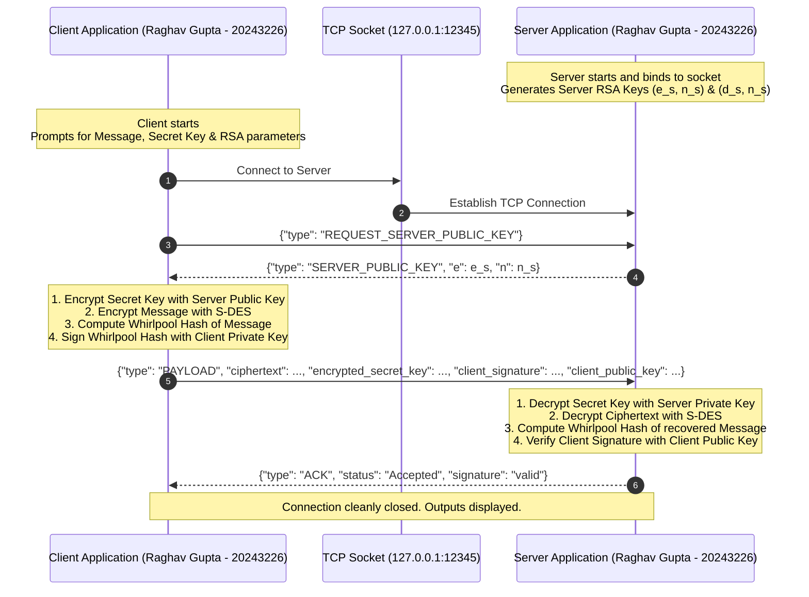
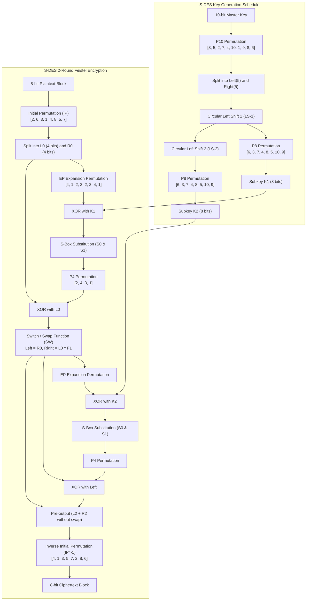
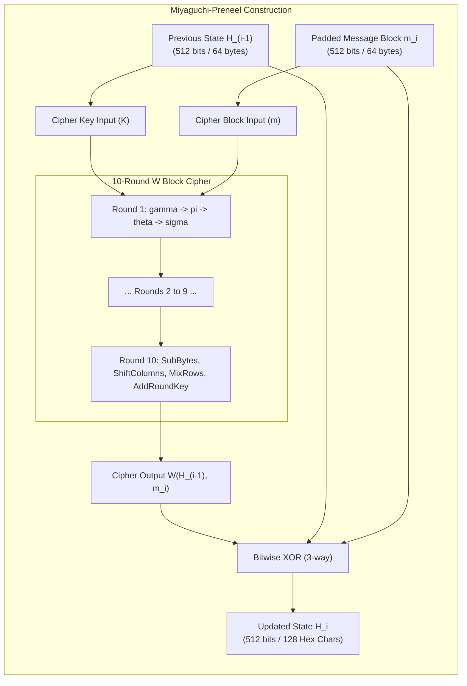
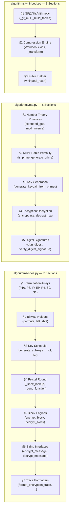

# Secure Client-Server Message Exchange Protocol
### Cryptography & Information Security - Assignment 1


-success?style=for-the-badge)

---

## Academic Credentials & Metadata

* **Author:** Raghav Gupta
* **Registration / Roll Number:** 20243226
* **Degree:** Bachelor of Technology (B.Tech)
* **Branch:** Computer Science and Engineering
* **Department:** Department of Computer Science & Engineering (CSED)
* **Institution:** Motilal Nehru National Institute of Technology (MNNIT) Allahabad
* **Course:** Information Security / Cryptography & Network Security
* **Submission Portal:** [Google Forms Submission Link](https://forms.gle/VS3dnQFCf37K9q2j7)
* **Final Submission Archive:** `20243226_Raghav_Gupta.zip`

---

## 1. Algorithm Selection Mapping

Based on the assignment formula using Roll Number **20243226**:

### 1.1 Symmetric Key Algorithm Assignment
$$\text{Roll No.} \pmod 3 = 20243226 \pmod 3$$
$$\text{Sum of digits} = 2 + 0 + 2 + 4 + 3 + 2 + 2 + 6 = 21$$
$$21 \pmod 3 = 0 \implies \mathbf{Simplified\ DES\ (S\text{-}DES)}$$

### 1.2 Asymmetric Key Algorithm Assignment
$$\text{Roll No.} \pmod 2 = 20243226 \pmod 2 = 0 \implies \mathbf{RSA}$$

### 1.3 Cryptographic Hash Algorithm
$$\mathbf{Whirlpool\ Hash\ Algorithm\ (Created\ from\ Scratch\ -\ ISO/IEC\ 10118\text{-}3)}$$

---

## 2. Visual Architecture & Protocol Diagrams

### 2.1 Complete End-to-End System Flowchart
The diagram below illustrates the exact cryptographic workflow implemented across the Client and Server processes (matching the assignment specification on Page 1):



---

### 2.2 Protocol Handshake & Message Sequence Diagram
The time-ordered network interaction between the Client and Server:



---

### 2.3 Simplified DES (S-DES) Cryptographic Engine
The block-by-block data path of the 10-bit key schedule and 2-round Feistel structure:



---

### 2.4 Whirlpool Miyaguchi-Preneel Compression Engine
The pure from-scratch implementation of ISO/IEC 10118-3 Whirlpool hashing:



---

## 3. Mathematical Specifications

### 3.1 Simplified DES (S-DES)
S-DES operates on an 8-bit plaintext block under a 10-bit master key:
- **Key Generation:**
  - $P10 = [3, 5, 2, 7, 4, 10, 1, 9, 8, 6]$
  - Split into two 5-bit halves $(L_0, R_0)$.
  - Circular left shift by 1 position ($LS\text{-}1$) on both halves $\to (L_1, R_1)$.
  - Apply $P8 = [6, 3, 7, 4, 8, 5, 10, 9] \to \text{Subkey } K_1$.
  - Circular left shift by 2 positions ($LS\text{-}2$) on $(L_1, R_1) \to (L_2, R_2)$.
  - Apply $P8 \to \text{Subkey } K_2$.
- **Encryption Process:**
  - Initial Permutation: $IP = [2, 6, 3, 1, 4, 8, 5, 7]$.
  - Expansion Permutation: $EP = [4, 1, 2, 3, 2, 3, 4, 1]$ expanding 4 bits to 8 bits.
  - S-Box substitution matrices:
    $$S_0 = \begin{pmatrix} 1 & 0 & 3 & 2 \\ 3 & 2 & 1 & 0 \\ 0 & 2 & 1 & 3 \\ 3 & 1 & 3 & 2 \end{pmatrix}, \quad S_1 = \begin{pmatrix} 0 & 1 & 2 & 3 \\ 2 & 0 & 1 & 3 \\ 3 & 0 & 1 & 0 \\ 2 & 1 & 0 & 3 \end{pmatrix}$$
  - Permutation $P4 = [2, 4, 3, 1]$.
  - Round 1: $L_1 = L_0 \oplus F(R_0, K_1)$, $R_1 = R_0$. Halves Swap: $(L_{sw}, R_{sw}) = (R_1, L_1)$.
  - Round 2: $L_2 = L_{sw} \oplus F(R_{sw}, K_2)$, $R_2 = R_{sw}$ (No swap).
  - Inverse Initial Permutation: $IP^{-1} = [4, 1, 3, 5, 7, 2, 8, 6]$.

### 3.2 RSA Public Key Cryptosystem
- **Key Generation:**
  - Select two distinct large prime numbers $p$ and $q$.
  - Modulus: $n = p \times q$.
  - Euler's totient: $\phi(n) = (p - 1)(q - 1)$.
  - Public exponent $e$ such that $1 < e < \phi(n)$ and $\gcd(e, \phi(n)) = 1$.
  - Private exponent $d$ using Extended Euclidean Algorithm:
    $$d \times e \equiv 1 \pmod{\phi(n)}$$
  - Public Key: $(e, n)$, Private Key: $(d, n)$.
- **Secret Key Encryption:** $c = m^e \pmod n$.
- **Secret Key Decryption:** $m = c^d \pmod n$.
- **Digital Signature Generation:** $S = H^d \pmod n$.
- **Digital Signature Verification:** $V = S^e \pmod n$. Valid iff $V = H \pmod n$.

### 3.3 Whirlpool Cryptographic Hash Function (from scratch)
- **Miyaguchi-Preneel Hashing:**
  $$H_i = W(H_{i-1}, m_i) \oplus H_{i-1} \oplus m_i$$
- **Padding Rule:** Append '1' bit (`0x80`), followed by $k$ zero bits such that $(L + 1 + k) \equiv 256 \pmod{512}$, then append the 256-bit big-endian representation of original bit-length $L$.
- **Galois Field Arithmetic:** Polynomial multiplication over $GF(2^8)$ modulo irreducible polynomial $x^8 + x^4 + x^3 + x^2 + 1$ (`0x11D`).
- **Diffusion Matrix:** Circulant row $[01, 01, 04, 01, 08, 05, 02, 09]$.

---

## 4. Complete Directory of Modular Packages, Files and Functions

The project follows a strict modular separation of concerns:
```text
crypto assignment/
├── algorithms/                      <-- Core cryptographic algorithms
│   ├── __init__.py                  <-- Unified package interface
│   ├── sdes.py                      <-- Part 1: Simplified DES (S-DES)
│   ├── rsa.py                       <-- Part 2: RSA Cryptosystem & Digital Signatures
│   └── whirlpool.py                 <-- Part 3: ISO Whirlpool Hash (From scratch)
├── network/                         <-- Network communication layer
│   ├── __init__.py                  <-- Package interface
│   └── protocol.py                  <-- Packet schemas & socket framing
├── client.py                        <-- Client application entry point
├── server.py                        <-- Server application entry point
├── main.py                          <-- Master interactive CLI launcher
├── run.bat                          <-- Windows 1-click desktop launcher
├── test_suite.py                    <-- Comprehensive unit test suite
├── run_demo.py                      <-- Automated batch runner & screenshot generator
├── .gitignore                       <-- Professional git ignore configuration
├── .vscode/                         <-- VS Code launch and task configurations
│   ├── launch.json
│   └── tasks.json
├── README.md                        <-- Comprehensive academic documentation
├── INSTRUCTIONS_AND_SUBMISSION.md   <-- Instructor evaluation guide
├── client_output.txt                <-- Captured client execution log
├── server_output.txt                <-- Captured server execution log
├── client_execution_screenshot.png  <-- Client execution window screenshot
├── server_execution_screenshot.png  <-- Server execution window screenshot
└── 20243226_Raghav_Gupta.zip        <-- Final submission archive
```

### 4.1 Detailed Module and Function Specifications

| Module / File | Internal Sections | Functions / Classes | Purpose & Functionality |
| :--- | :--- | :--- | :--- |
| **`algorithms/sdes.py`** | **7 Sections:**<br>§1 Permutation Arrays & S-Box Definitions<br>§2 Bitwise Helper Functions<br>§3 Key Schedule Generator<br>§4 Feistel Round Function<br>§5 Block-Level Engines<br>§6 String-Level Interfaces<br>§7 Trace Formatters | `permute(bits, table)`<br>`left_shift(bits, n)`<br>`generate_subkeys(key_10bit)`<br>`_sbox_lookup(nibble, box)`<br>`_round_function(r, k)`<br>`encrypt_block_with_trace()`<br>`decrypt_block_with_trace()`<br>`encrypt_message()`<br>`decrypt_message()`<br>`format_encryption_trace()`<br>`format_decryption_trace()` | **Part 1 Symmetric Block Cipher.** Generates 8-bit subkeys $K_1, K_2$ via $P10, LS\text{-}1, LS\text{-}2, P8$. Executes 2-round Feistel network with $IP, EP, S_0/S_1, P4, SW, IP^{-1}$. Encrypts/decrypts arbitrary strings block-by-block with granular tracing. Textbook references: *Stallings* Ch. 4 & *Schaefer (1996)*. |
| **`algorithms/rsa.py`** | **5 Sections:**<br>§1 Number Theory Primitives<br>§2 Miller-Rabin Primality Test<br>§3 Key Generation<br>§4 Asymmetric Encryption/Decryption<br>§5 Digital Signatures | `extended_gcd(a, b)`<br>`mod_inverse(e, phi)`<br>`is_prime(n, k)`<br>`generate_prime(bits)`<br>`generate_keypair_from_primes()`<br>`generate_rsa_keys(bits)`<br>`encrypt_rsa(m, pub)`<br>`decrypt_rsa(c, priv)`<br>`sign_digest(digest, priv)`<br>`verify_digest_signature()` | **Part 2 Asymmetric Cryptosystem.** Derives $(e, n)$ and $(d, n)$ with Miller-Rabin primality ($k=40$) and Extended Euclidean modular inverse. Performs secret key encryption/decryption and Whirlpool digital signature signing and verification. Documents Bezout's Identity and Euler's Totient Theorem inline. |
| **`algorithms/whirlpool.py`** | **3 Sections:**<br>§1 GF(2⁸) Arithmetic & Table Precomputation<br>§2 Miyaguchi-Preneel Compression Engine<br>§3 Public Convenience Helper | `_gf_mul(a, b)`<br>`_build_tables()`<br>`Whirlpool` class<br>`Whirlpool.update(data)`<br>`Whirlpool._transform(block)`<br>`Whirlpool.digest()`<br>`Whirlpool.hexdigest()`<br>`whirlpool_hash(data)` | **Part 3 Cryptographic Hash (from scratch).** Pure Python ISO/IEC 10118-3 implementation. Performs $GF(2^8)$ multiplication modulo irreducible polynomial `0x11D`, precomputes 8 circular round tables, runs 10-round Miyaguchi-Preneel compression, and generates 512-bit digests (128 hex chars). |
| **`algorithms/__init__.py`** | — | Unified Package API | Exposes unified algorithm interfaces for modular imports. |
| **`network/protocol.py`** | — | `MessageProtocol`<br>`send_json(sock, dict)`<br>`recv_json(sock, buffer)` | **Network Framing & Schemas.** Defines standard message schemas (`REQ_PUBLIC_KEY`, `RESP_PUBLIC_KEY`, `PAYLOAD`, `ACK`), handles JSON framing, newline delimitation, and socket serialization. |
| **`network/__init__.py`** | — | Network Package API | Exposes protocol message builders and transmission functions. |
| **`server.py`** | Step-by-step comments cite exact **Page 2 & Page 3** bullet points from the question paper | `get_interactive_server_inputs()`<br>`run_server(host, port, ...)`<br>`main()` | **Server Application Entry Point.** Prompts for RSA key parameters, receives encrypted payload, decrypts secret key with RSA, decrypts ciphertext with S-DES, hashes recovered message with Whirlpool, verifies digital signature, and prints formatted output. |
| **`client.py`** | Step-by-step comments cite exact **Page 1 & Page 2** bullet points from the question paper | `get_interactive_inputs()`<br>`run_client(host, port, ...)`<br>`main()` | **Client Application Entry Point.** Prompts for Message, Secret Key, Public Key, and Private Key parameters, retrieves Server Public Key, encrypts secret key with RSA, encrypts message with S-DES, hashes message with Whirlpool, signs hash with RSA, and transmits payload bundle. |
| **`main.py`** | — | `run_side_by_side_demo()`<br>`run_inline_server()`<br>`run_inline_client()`<br>`run_test_suite()`<br>`run_batch_demo()`<br>`package_zip()` | **Master Control Panel.** Interactive numbered CLI menu enabling multi-window demo launches, interactive testing, and automated zip re-packaging. |
| **`run_demo.py`** | — | `capture_execution()`<br>`render_terminal_screenshot()` | **Automated Demo & Visualizer.** Runs client and server end-to-end, logs stdout to `.txt` files, and renders high-resolution terminal window screenshots (`.png`). |
| **`run.bat`** | — | Windows Batch Script | One-click desktop launcher to immediately start `main.py` in Windows. |
| **`test_suite.py`** | — | `TestCryptoAssignment` | Comprehensive unit tests for S-DES textbook vectors, Whirlpool ISO vectors, RSA arithmetic, and socket network integration. |
| **`sdes.py`, `rsa.py`, `whirlpool.py`** | — | Re-exporters | Root-level re-exporters forwarding to `algorithms/` for backward compatibility. |
| **`client_output.txt`, `server_output.txt`** | — | Text Logs | Raw execution output logs for Client and Server matching the exact required format. |
| **`client_execution_screenshot.png`, `server_execution_screenshot.png`** | — | Images | Rendered terminal window screenshots of Client encryption and Server decryption. |
| **`INSTRUCTIONS_AND_SUBMISSION.md`** | — | Evaluation Report | Mapping of assignment requirements to code with grading audit. |
| **`20243226_Raghav_Gupta.zip`** | — | Zip Archive | Final submission package containing all modules and documentation. |

---

## 5. Academic Code Annotations Guide

Every `.py` file in this project is structured for easy inspection by an evaluator or professor. Each algorithm file is divided into numbered **SECTION banners** visible at the top level without any IDE navigation required.

### 5.1 How to Navigate the Source Code

Open any algorithm file — the section banners appear as large block comments:

```python
# ============================================================================
# SECTION 1: PERMUTATION ARRAYS & S-BOX DEFINITIONS (STANDARD STALLINGS)
# ============================================================================
```

This makes it immediately clear **where each part of the algorithm lives** and **which textbook it comes from**.

### 5.2 Per-File Annotation Structure



### 5.3 Inline Docstring Format

Every function carries a docstring in the following academic format:

```python
def generate_subkeys(key_10bit):
    """
    S-DES Key Schedule — Generates subkeys K1 and K2 from a 10-bit master key.

    Algorithm (from Stallings, Chapter 4):
        1. Apply P10 permutation to the 10-bit key
        2. Split into two 5-bit halves (L, R)
        3. Circular Left Shift by 1 position (LS-1) on both halves
        4. Apply P8 to combined halves → Subkey K1 (8 bits)
        5. Circular Left Shift by 2 more positions (LS-2) on shifted halves
        6. Apply P8 to combined halves → Subkey K2 (8 bits)

    Parameters:
        key_10bit (list[int]): 10-element list of 0/1 bits
    Returns:
        (K1, K2): tuple of two 8-element bit lists
    """
```

### 5.4 client.py & server.py Question Paper Citations

Both `client.py` and `server.py` contain inline comments that map each processing step directly to the exact bullet point from the assignment question paper:

```python
# --- STEP 2 (Page 1, Bullet 2): Encrypt Secret Key with Server's Public Key ---
# The 10-bit integer secret key is encrypted using RSA: c = m^e mod n
# where (e, n) = server_public_key
encrypted_secret_key = encrypt_rsa(secret_key_int, server_public_key)
```

This means a professor can open `client.py`, find the comment citing "Page 1, Bullet 2", and immediately cross-reference it with the question paper — **no guesswork required**.

### 5.5 No External Libraries Used

```python
# Standard library only — guaranteed zero installation for any evaluator
import socket
import json
import random
import math
import struct
import os
import sys
```

All cryptographic operations (prime generation, modular exponentiation, GF arithmetic) are implemented from scratch using only Python built-ins.

---

## 6. Execution Instructions for Evaluation

The application is written in standard Python 3 and runs on any platform with **zero external dependencies**.

### Method 1: Master Interactive Launcher (Recommended)
Open a terminal in the project directory and run:
```powershell
py main.py
```
*(Or double-click `run.bat` on Windows)*.

You will be greeted by the interactive control panel:
* **Select `[1]`** to instantly spawn Server and Client in **two side-by-side terminal windows**.
* **Select `[2]`** to run the Server interactively.
* **Select `[3]`** to run the Client in interactive mode with custom input messages and keys.
* **Select `[4]`** to run the automated unit test suite.
* **Select `[5]`** to run the batch demo and regenerate screenshots.
* **Select `[6]`** to re-package the final submission ZIP.

### Method 2: Manual Side-by-Side Terminals
Open two separate terminal windows (or VS Code split terminals):

**Terminal 1 (Server):**
```powershell
py server.py --port 12345 --interactive
```

**Terminal 2 (Client):**
```powershell
py client.py --port 12345 --interactive
```

### Method 3: Automated Test Suite
```powershell
py test_suite.py
```

---

## 7. Exact Formatted Execution Output

### 7.1 Client Side Output (Matches Required Template):
```text
Client Side:
Input: Message: <ANTIGRAVITY SECURE PROTOCOL - RAGHAV GUPTA (20243226)>
Secret Key: <1010000010>
Public Key parameters: (e=65537, n=1414619119789195648366439989948751329219586354582150811391082184793843398519446195257469136238930506151763430508881520155914590976147291059348245947042419460237033248793)
Private key parameters: (d=292606875320236449780360109613581229212516786284322388867624549446348491849331104915969578977230070779908606743171211251204799151247015400231880911686391020542712541777, n=1414619119789195648366439989948751329219586354582150811391082184793843398519446195257469136238930506151763430508881520155914590976147291059348245947042419460237033248793)
Encrypted Secret Key: <27535575404219596719712410773485120554274132088873023815659622460709890076005307468049078155651912431533460712256819191721379029452947615821789578162957770966087835597>

Intermediate encryption process:
--- Intermediate Encryption Process ---
1. Key Generation (10-bit key: 1010000010):
   P10 Permutation: 1000001100 -> Left: 10000, Right: 01100
   Left Shift 1 (LS-1): Left: 00001, Right: 11000
   Subkey K1 (P8 applied): 10100100
   Left Shift 2 (LS-2): Left: 00100, Right: 00011
   Subkey K2 (P8 applied): 01000011

2. Block-by-Block S-DES Encryption (showing 3 of 53 block(s)):
   [Block 1: Char 'A' (ASCII 65 = 01000001)]
     -> Initial Permutation (IP): 10000100 (L0: 1000, R0: 0100)
     -> Round 1 (Subkey K1=10100100):
        EP(R0): 00101000 ^ K1 = 10001100
        S-boxes: S0->00, S1->01 | P4: 0100
        L0 ^ P4 = 1100 | After Swap (SW): Left=0100, Right=1100
     -> Round 2 (Subkey K2=01000011):
        EP(R_sw): 01101001 ^ K2 = 00101010
        S-boxes: S0->00, S1->00 | P4: 0000
        Pre-output: 01001100
     -> Inverse IP (IP^-1): 00010101
   [Block 2: Char 'N' (ASCII 78 = 01001110)]
     -> Initial Permutation (IP): 11000011 (L0: 1100, R0: 0011)
     -> Round 1 (Subkey K1=10100100):
        EP(R0): 10010110 ^ K1 = 00110010
        S-boxes: S0->10, S1->01 | P4: 0101
        L0 ^ P4 = 1001 | After Swap (SW): Left=0011, Right=1001
     -> Round 2 (Subkey K2=01000011):
        EP(R_sw): 11000011 ^ K2 = 10000000
        S-boxes: S0->00, S1->00 | P4: 0000
        Pre-output: 00111001
     -> Inverse IP (IP^-1): 10110010
   [Block 3: Char 'T' (ASCII 84 = 01010100)]
     -> Initial Permutation (IP): 11001000 (L0: 1100, R0: 1000)
     -> Round 1 (Subkey K1=10100100):
        EP(R0): 01000001 ^ K1 = 11100101
        S-boxes: S0->11, S1->01 | P4: 1101
        L0 ^ P4 = 0001 | After Swap (SW): Left=1000, Right=0001
     -> Round 2 (Subkey K2=01000011):
        EP(R_sw): 10000010 ^ K2 = 11000001
        S-boxes: S0->01, S1->10 | P4: 1010
        Pre-output: 00100001
     -> Inverse IP (IP^-1): 00100010
   ... (50 remaining block(s) encrypted similarly)

Cipher text: <15b222af019f153aaf22aa624f5044c19f5062a39f4722474447a56236629f1501e0153a6201c1a3221562dc231f23ba732323a293>
Hash code: <fd7b348520c15e0a64618da2abd975bf6dd4991bb06c20cf8bf7a72f80ab84e5210e5ed41a314fba9d471a5150d8f17aad64766dd1bf8bb39afce8e8b8a075ad>
Digital Signature: <1196850174425335996620642141383777095915052422921150604922165174064005122335396726622619572881512853048012004008047184393010087772441384041170849518399153024753790393247>
```

### 7.2 Server Side Output (Matches Required Template):
```text
Server Side:
Input: Public Key parameters: (e=65537, n=2423798548860765760040562872152925396393896995348787681268917065207347503245451823176969367834795381184142089174392651492496844298527623500350274629419878043242667614543)
       Private key parameters: (d=636599850794823703062059732950368568108521125180259736601948051381876994268336393675199823741140388072449902658657447877908212017734777112800433839666256039447126180713, n=2423798548860765760040562872152925396393896995348787681268917065207347503245451823176969367834795381184142089174392651492496844298527623500350274629419878043242667614543)
Decrypted Secret key: 1010000010 (integer: 642)

Intermediate decryption process:
--- Intermediate Decryption Process ---
1. Subkeys Used (K2 first, then K1):
   Subkey K2: 01000011
   Subkey K1: 10100100

2. Block-by-Block S-DES Decryption (showing 3 of 53 block(s)):
   [Block 1: Cipher bits 00010101]
     -> Initial Permutation (IP): 01001100 (L0: 0100, R0: 1100)
     -> Round 1 (Subkey K2=01000011):
        EP(R0): 01101001 ^ K2 = 00101010
        S-boxes: S0->00, S1->00 | P4: 0000
        L0 ^ P4 = 0100 | After Swap (SW): Left=1100, Right=0100
     -> Round 2 (Subkey K1=10100100):
        EP(R_sw): 00101000 ^ K1 = 10001100
        S-boxes: S0->00, S1->01 | P4: 0100
        Pre-output: 10000100
     -> Inverse IP (IP^-1): 01000001 -> Decrypted Char: 'A' (ASCII 65)
   [Block 2: Cipher bits 10110010]
     -> Initial Permutation (IP): 00111001 (L0: 0011, R0: 1001)
     -> Round 1 (Subkey K2=01000011):
        EP(R0): 11000011 ^ K2 = 10000000
        S-boxes: S0->00, S1->00 | P4: 0000
        L0 ^ P4 = 0011 | After Swap (SW): Left=1001, Right=0011
     -> Round 2 (Subkey K1=10100100):
        EP(R_sw): 10010110 ^ K1 = 00110010
        S-boxes: S0->10, S1->01 | P4: 0101
        Pre-output: 11000011
     -> Inverse IP (IP^-1): 01001110 -> Decrypted Char: 'N' (ASCII 78)
   [Block 3: Cipher bits 00100010]
     -> Initial Permutation (IP): 00100001 (L0: 0010, R0: 0001)
     -> Round 1 (Subkey K2=01000011):
        EP(R0): 10000010 ^ K2 = 11000001
        S-boxes: S0->01, S1->10 | P4: 1010
        L0 ^ P4 = 1000 | After Swap (SW): Left=0001, Right=1000
     -> Round 2 (Subkey K1=10100100):
        EP(R_sw): 01000001 ^ K1 = 11100101
        S-boxes: S0->11, S1->01 | P4: 1101
        Pre-output: 11001000
     -> Inverse IP (IP^-1): 01010100 -> Decrypted Char: 'T' (ASCII 84)
   ... (50 remaining block(s) decrypted similarly)

Decrypt Message: ANTIGRAVITY SECURE PROTOCOL - RAGHAV GUPTA (20243226)
Hash code: fd7b348520c15e0a64618da2abd975bf6dd4991bb06c20cf8bf7a72f80ab84e5210e5ed41a314fba9d471a5150d8f17aad64766dd1bf8bb39afce8e8b8a075ad
Verification code: fd7b348520c15e0a64618da2abd975bf6dd4991bb06c20cf8bf7a72f80ab84e5210e5ed41a314fba9d471a5150d8f17aad64766dd1bf8bb39afce8e8b8a075ad
Signature: <valid>
Message: <Accepted>
```

---

## 8. Submission Checklist Verification

- [x] **Platform Independent & Command Line Executable (Rule 1):** Pure Python 3 standard library, executable on any OS without pip dependencies.
- [x] **Author Details in Every Code File (Rule 2):** Name (`Raghav Gupta`) and Roll Number (`20243226`) explicitly stated in every file header and docstring.
- [x] **Detailed README File (Rule 3):** Complete guide with visual architecture diagrams, mathematical proofs, and function directories.
- [x] **ZIP File for Submission (Rule 4):** Fully bundled in `20243226_Raghav_Gupta.zip`.
- [x] **Sample Output Files & Screenshots (Rule 5):** Text logs (`client_output.txt`, `server_output.txt`) and high-resolution terminal window screenshots (`client_execution_screenshot.png`, `server_execution_screenshot.png`).
- [x] **ZIP Renamed Correctly (Rule 6):** Formatted as `20243226_Raghav_Gupta.zip`.
